

# Plan de l'oral (≈ 8 min)

| Partie | Durée |
|---|---|
| 1. Introduction : le dataset | 45 s |
| 2. Nettoyage des données | 1 min 30 |
| 3. Détection des fuites | 1 min |
| 4. Élaboration du modèle | 4 min |
| 5. Test final et conclusion | 1 min 30 |

Les numéros entre crochets [n] sont les numéros des cellules du notebook (en comptant à partir de 1).

---

## 1. Introduction : le dataset (≈ 45 s)

**Montrer** : la cellule markdown du titre [1].

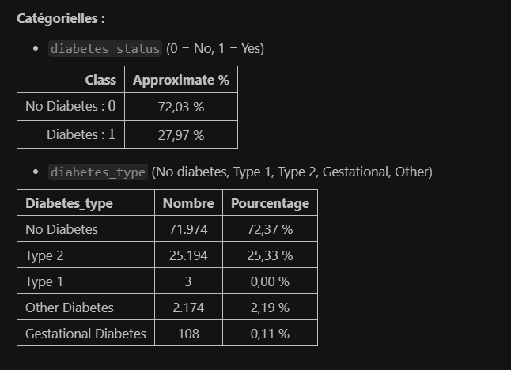

**À dire** :
- « Dataset Kaggle synthétique : 100 000 patients et 209 variables (biologie, mode de vie, environnement, antécédents…). »
- « La cible est `diabetes_status`. Il y a 28 % de diabétiques, donc les classes sont déséquilibrées. J'ai écarté `diabetes_type` : Type 1 et gestationnel sont presque absents. »
- « **Objectif** : un outil de **dépistage** qui utilise seulement des analyses sanguines et des données simples, sans avis d'expert, pour être appliqué au plus grand nombre de patients. »

---

## 2. Nettoyage des données (≈ 1 min 30)

**Montrer** : le markdown 1.1 [6], puis le graphique de l'entonnoir [8].

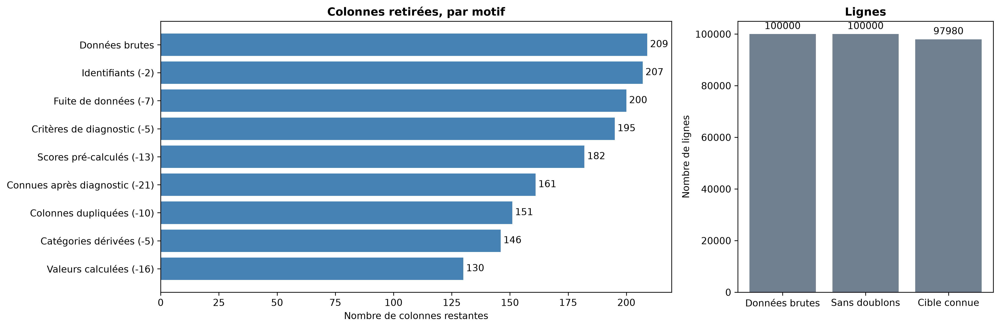

- « J'ai retiré trois familles de colonnes : les fuites de données (diagnostic, traitement), les scores "experts" dont on ne connaît pas le calcul, et les doublons. On passe de 209 à 130 colonnes et à 97 980 lignes. »

**Montrer** : le tableau croisé `sex` × `pregnancy_status` [24].

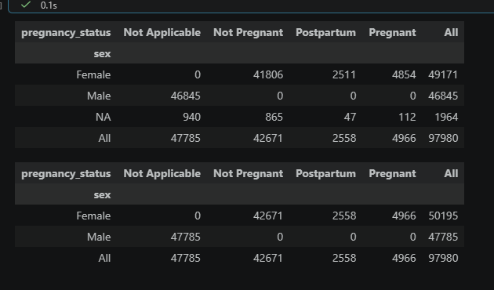

- « Avant d'imputer, je remplis d'abord les NaN "logiques". Par exemple, `pregnancy_status = Not Applicable` implique un homme. »

**Montrer** : le tableau des 4 groupes de la fonction `Clean` [22]. Survole-le, ne le lis pas.

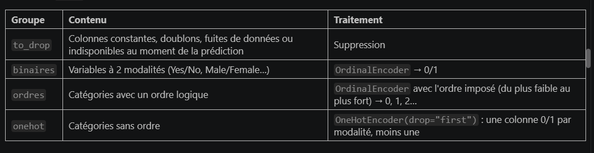

- « Le pipeline encode les colonnes (binaires, ordinales, OneHot), puis impute avec `IterativeImputer`. Il est ajusté **sur le train uniquement**. »

**Montrer** : le tableau SMD / KS [35]. Une phrase suffit.

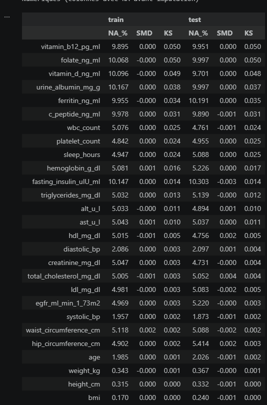

- « Je vérifie que l'imputation ne déforme pas les distributions : SMD ≈ 0 et KS faible, sur le train comme sur le test. »

---

## 3. Détection des fuites (≈ 1 min)

**Montrer** : la courbe de retrait glouton [38].

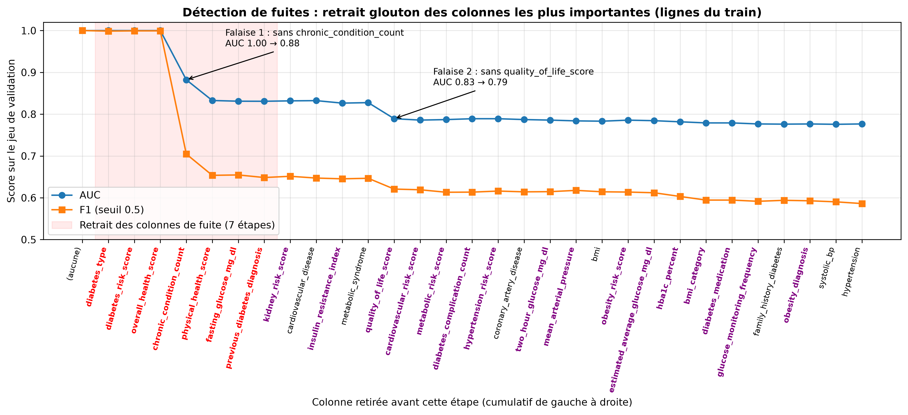

- « Pour vérifier qu'il ne reste pas de fuite, je retire à chaque étape la colonne la plus importante pour XGBoost. L'AUC reste à 1 tant qu'il reste une colonne qui contient la réponse. Elle chute à 0,88 sans `chronic_condition_count`, puis se stabilise vers 0,83. Ces 7 colonnes en rouge sont mes fuites. »

**Montrer** (rapidement) : le récapitulatif des 4 jeux [38].

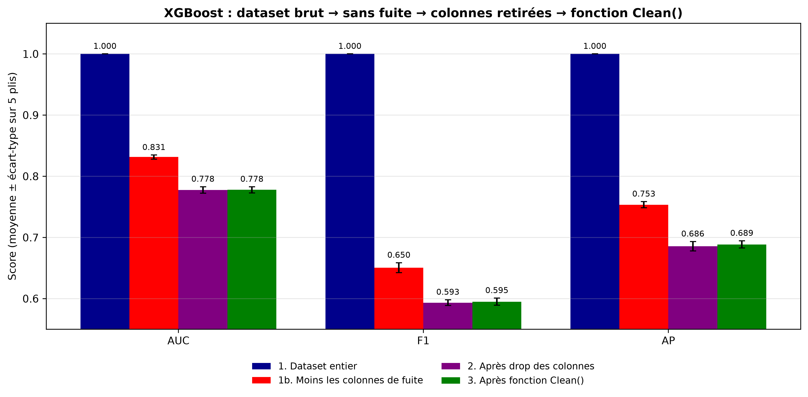

- « Récapitulatif : avec les fuites on obtient un score parfait, mais faux. Sans elles, on a le vrai niveau du problème. »

---

## 4. Élaboration du modèle (≈ 4 min) : le cœur de l'oral

### 4a. Premiers modèles (20 s) [43]

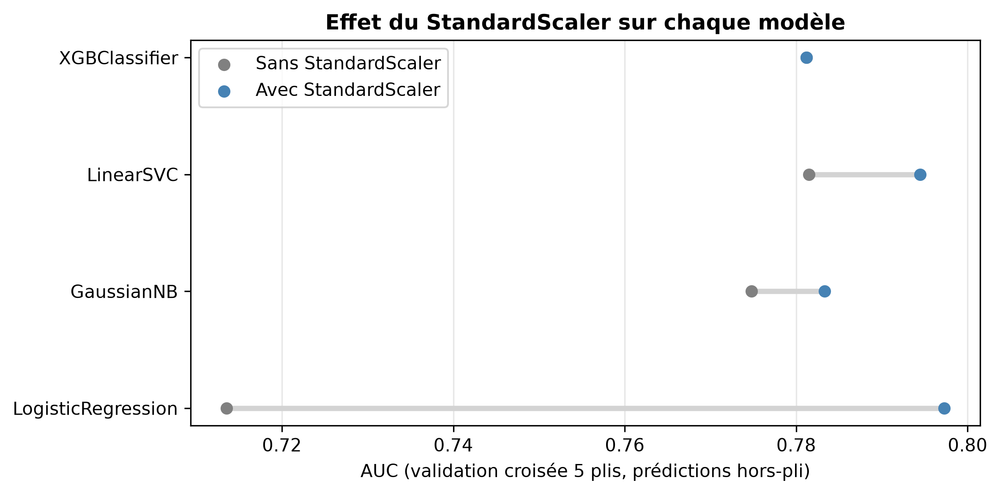

- « Premier essai avec des modèles naïfs. La standardisation aide nettement la régression logistique. »

### 4b. Filtrage avancé (20 s) [48]

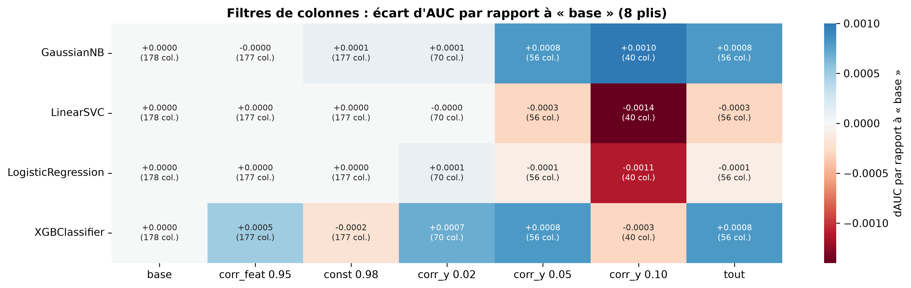

- « Les filtres simples (variance, corrélation) retirent des colonnes sans perte d'AUC. »

### 4c. Sélection de variables (1 min 15)

**Montrer** : le tableau des familles de méthodes [49].

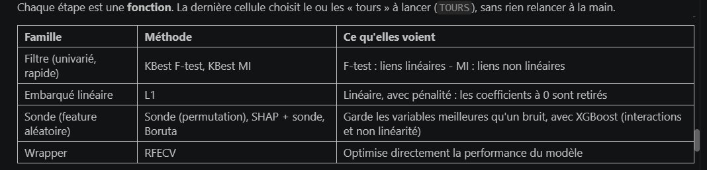

- « 7 méthodes de 4 familles : filtres, L1, sondes aléatoires (Boruta, SHAP), RFECV. Toutes sont évaluées sur les mêmes 10 plis. »

**Montrer** : la stabilité des méthodes [66].

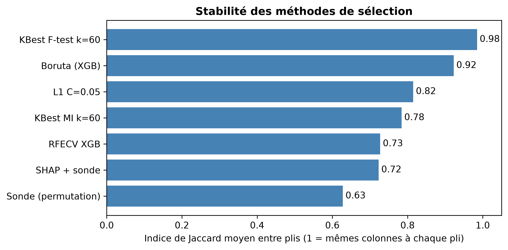

- « Une méthode qui choisit des colonnes différentes à chaque pli n'est pas fiable. Je mesure donc sa stabilité avec l'indice de Jaccard. »

**Montrer** : le choix du consensus [71].

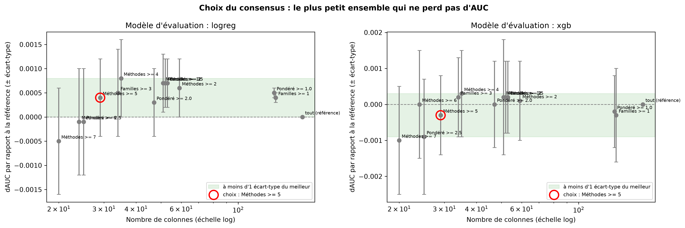

- « Je garde les colonnes choisies par au moins 5 méthodes. On passe de **178 colonnes à 27, sans perte d'AUC** (dAUC ≈ 0). »

### 4d. Choix du modèle (30 s) [75]

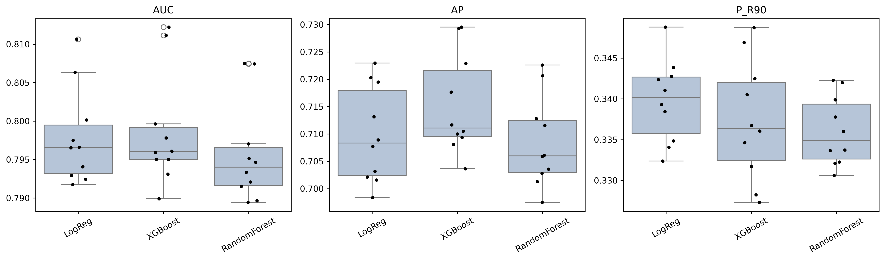

- « Logistique, XGBoost et forêt aléatoire font tous environ 0,80 d'AUC, bien au-dessus du Dummy. Je garde la logistique et XGBoost. »

### 4e. Hyperparamètres (45 s)

**Montrer** : le markdown 6.2 [76], puis le graphique avant / après réglage [78].

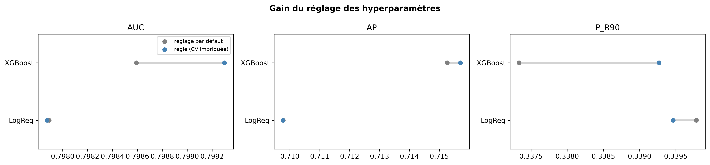

- « J'ai utilisé `RandomizedSearchCV` dans une **validation croisée imbriquée**, pour que le réglage ne gonfle pas les scores. Le critère est l'AP. Le gain est de quelques millièmes seulement : c'est la limite des données, pas du modèle. »

### 4f. Vote et seuil (50 s)

**Montrer** : le poids du vote [81].

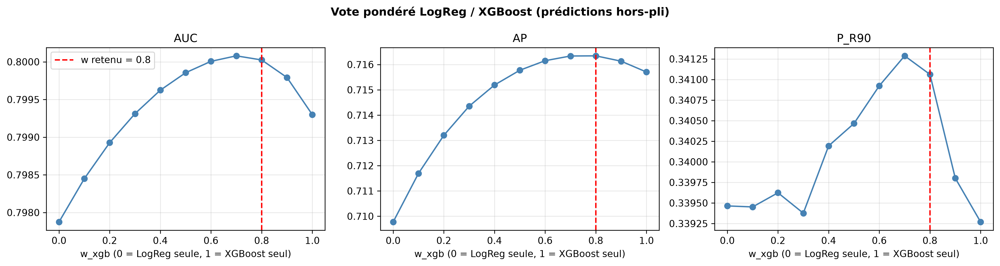

- « Je moyenne les probabilités des deux modèles. Le meilleur poids est 0,8 pour XGBoost. »

**Montrer** : le choix du seuil [84].

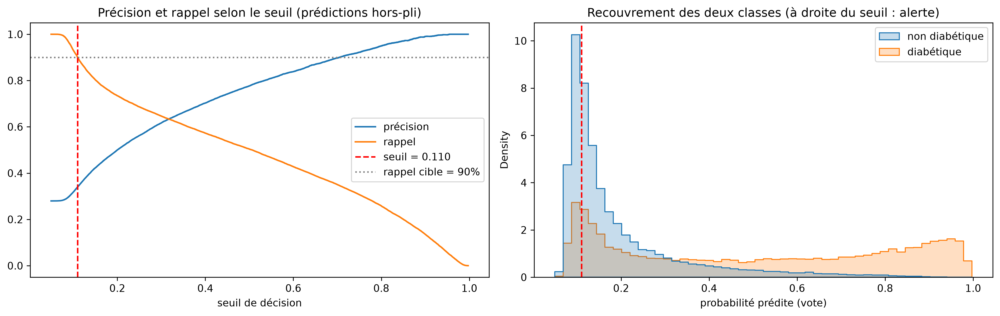

- « En dépistage, rater un diabétique coûte cher. Je fixe donc le seuil pour détecter 90 % des diabétiques : seuil = 0,11, précision = 0,34. »

---

## 5. Test final et conclusion (≈ 1 min 30)

**Montrer** : la sortie [87] (intervalles de confiance), puis les graphiques [88] et [89].

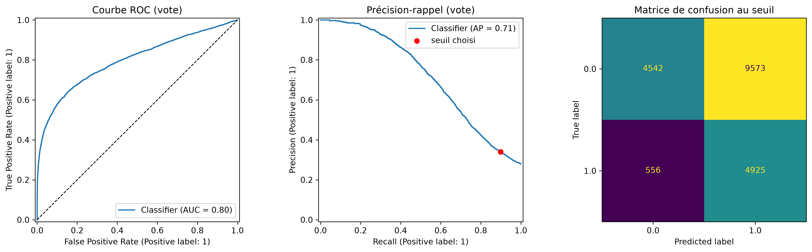

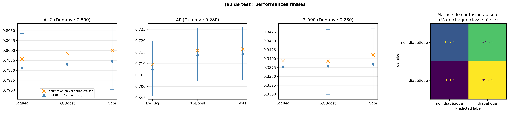

- « Le test est utilisé **une seule fois**, tout étant figé. AUC entre 0,79 et 0,81, rappel 0,90, précision 0,34. C'est cohérent avec la validation croisée : le modèle généralise, et la sélection n'a pas surappris. »

**Montrer** : le bilan [94], puis le markdown 7.3 [93].

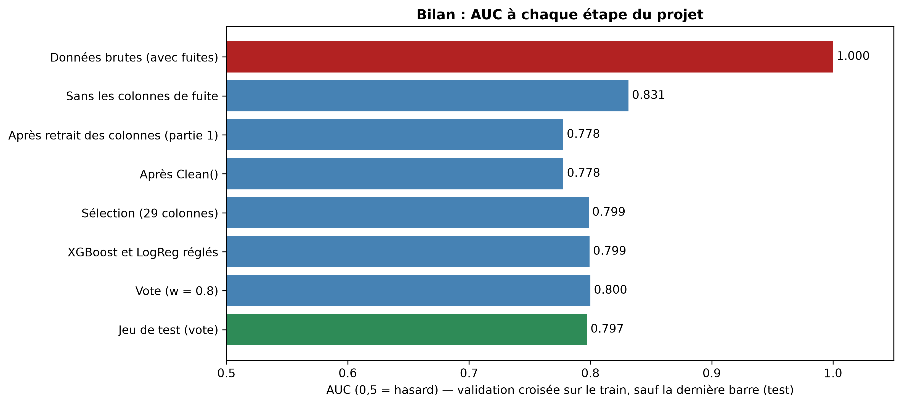

- « Plafond autour de 0,80 quel que soit le modèle. Limite : 2 alertes sur 3 sont fausses, et **74 % des patients sont signalés**. C'est un outil d'orientation vers un examen, pas un diagnostic. Pistes : régler le compromis rappel/précision selon le coût d'une fausse alerte, ou trouver de meilleures variables. »

---

## Si je suis en retard, couper dans cet ordre

1. 4a (premiers modèles)
2. 4b (filtres)
3. Le tableau SMD / KS [35]
4. Le récapitulatif `recap_etapes_xgboost`

## À corriger avant l'oral

- [ ] **Markdown 3.2 [39]** : il reste « QUElle métrique ??? » dans le tableau. Indiquer la métrique ou retirer la ligne.
- [ ] **Le 74 % d'alertes** : préparer une réponse (question probable du jury). Pour atteindre 90 % de rappel avec 28 % de diabétiques et une AUC de 0,80, il faut alerter très large.

## Graphiques en réserve (si le jury pose une question)

| Question possible | Graphique |
|---|---|
| Valeurs aberrantes ? | 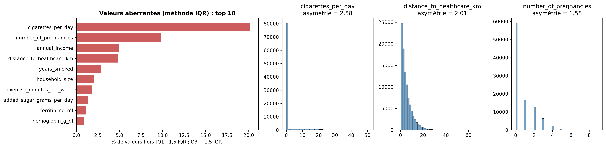 |
| Corrélations avec la cible ? | 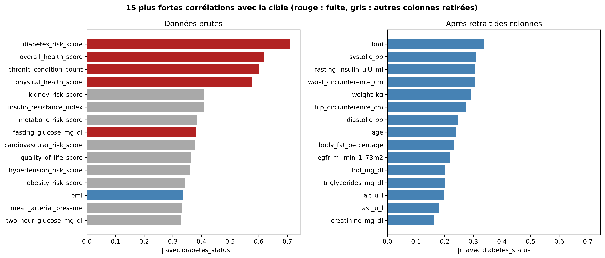 |
| Nombre de colonnes vs performance par méthode ? | 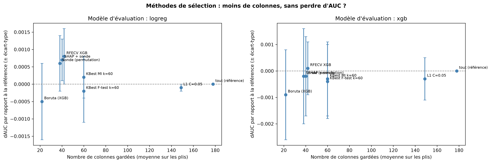 |
| Hyperparamètres stables d'un pli à l'autre ? | 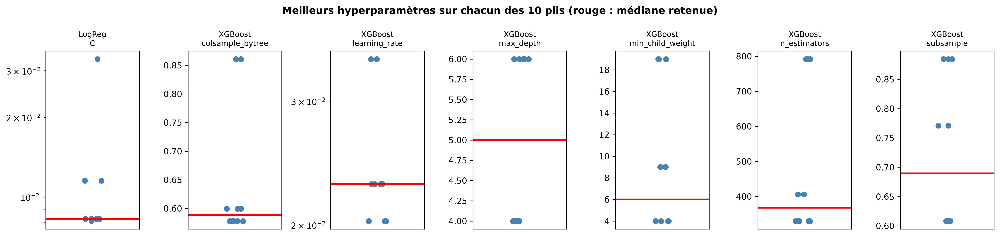 |
| Quelles variables comptent le plus ? | 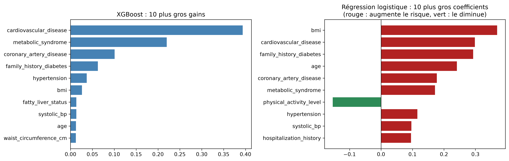 |
